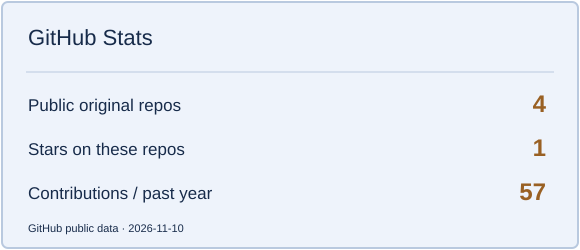
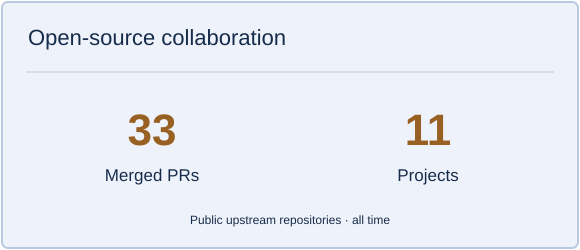
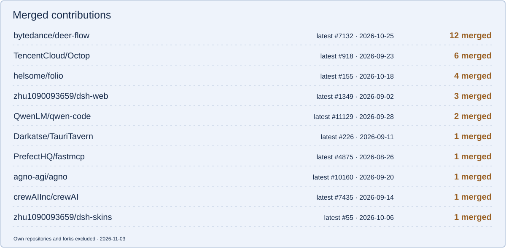

<picture>
  <source media="(prefers-color-scheme: dark)" srcset="https://raw.githubusercontent.com/67-luck/github-profile-themes/main/themes/deepseek-orbit/assets/hero-dark.svg">
  <source media="(prefers-color-scheme: light)" srcset="https://raw.githubusercontent.com/67-luck/github-profile-themes/main/themes/deepseek-orbit/assets/hero-light.svg">
  
</picture>

### about

- **王浩** · 构建 Coding Agent、MCP 工具链与 AI 全栈产品
- 专注 Agent runtime、异步系统与开源协作
- 作品：[Blog](https://github.com/67-luck/Blog) · [Folio](https://github.com/67-luck/folio) · [博客](https://www.cqytxy.edu.cn/)

<picture>
  <source media="(prefers-color-scheme: dark)" srcset="https://raw.githubusercontent.com/67-luck/github-profile-themes/main/themes/deepseek-orbit/assets/divider-dark.svg">
  <source media="(prefers-color-scheme: light)" srcset="https://raw.githubusercontent.com/67-luck/github-profile-themes/main/themes/deepseek-orbit/assets/divider-light.svg">
  
</picture>

### open-source notebook

<picture>
  <source media="(prefers-color-scheme: dark)" srcset="https://raw.githubusercontent.com/67-luck/github-profile-themes/main/themes/deepseek-orbit/assets/stats-dark.svg">
  <source media="(prefers-color-scheme: light)" srcset="https://raw.githubusercontent.com/67-luck/github-profile-themes/main/themes/deepseek-orbit/assets/stats-light.svg">
  
</picture>
<picture>
  <source media="(prefers-color-scheme: dark)" srcset="https://raw.githubusercontent.com/67-luck/github-profile-themes/main/themes/deepseek-orbit/assets/collaboration-dark.svg">
  <source media="(prefers-color-scheme: light)" srcset="https://raw.githubusercontent.com/67-luck/github-profile-themes/main/themes/deepseek-orbit/assets/collaboration-light.svg">
  
</picture>

<picture>
  <source media="(prefers-color-scheme: dark)" srcset="https://raw.githubusercontent.com/67-luck/github-profile-themes/main/themes/deepseek-orbit/assets/projects-dark.svg">
  <source media="(prefers-color-scheme: light)" srcset="https://raw.githubusercontent.com/67-luck/github-profile-themes/main/themes/deepseek-orbit/assets/projects-light.svg">
  
</picture>

**Selected merged PRs**

- **PrefectHQ/fastmcp** — [fix(skills): follow empty pagination cursors when listing skills #6473](https://github.com/PrefectHQ/fastmcp/pull/6473)
- **bytedance/deer-flow** — [fix(sandbox): match local grep lines without their terminator #8210](https://github.com/bytedance/deer-flow/pull/8210)
- **openclaw/openclaw** — [improve(ollama): cover literal fenced command replies #166561](https://github.com/openclaw/openclaw/pull/166561)

<picture>
  <source media="(prefers-color-scheme: dark)" srcset="https://raw.githubusercontent.com/67-luck/github-profile-themes/main/themes/deepseek-orbit/assets/footer-dark.svg">
  <source media="(prefers-color-scheme: light)" srcset="https://raw.githubusercontent.com/67-luck/github-profile-themes/main/themes/deepseek-orbit/assets/footer-light.svg">
  
</picture>

Theme: Whale Orbit · [Theme collection](https://github.com/67-luck/github-profile-themes) · [Artwork sources](https://github.com/67-luck/github-profile-themes/blob/main/SOURCES.md)
